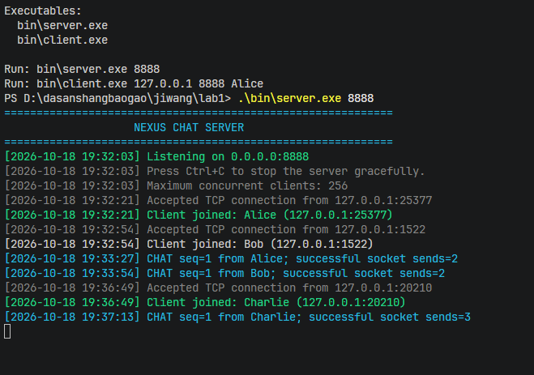
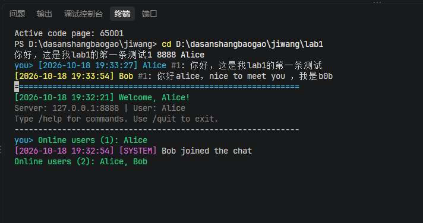
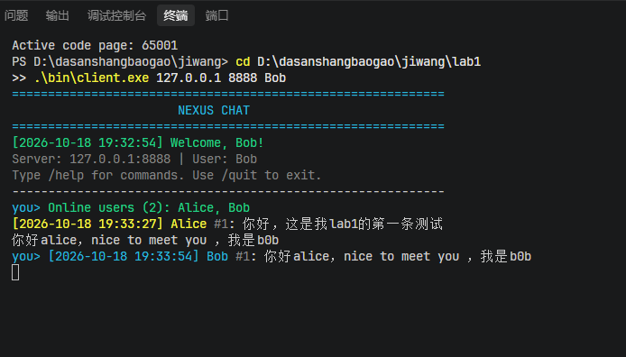
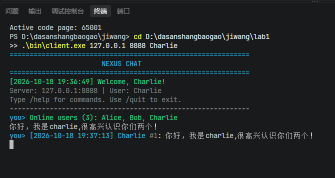
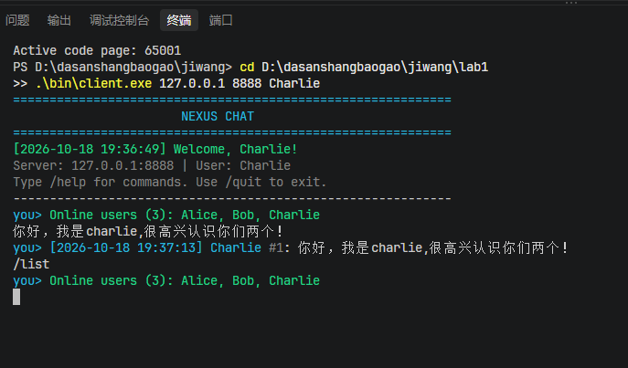
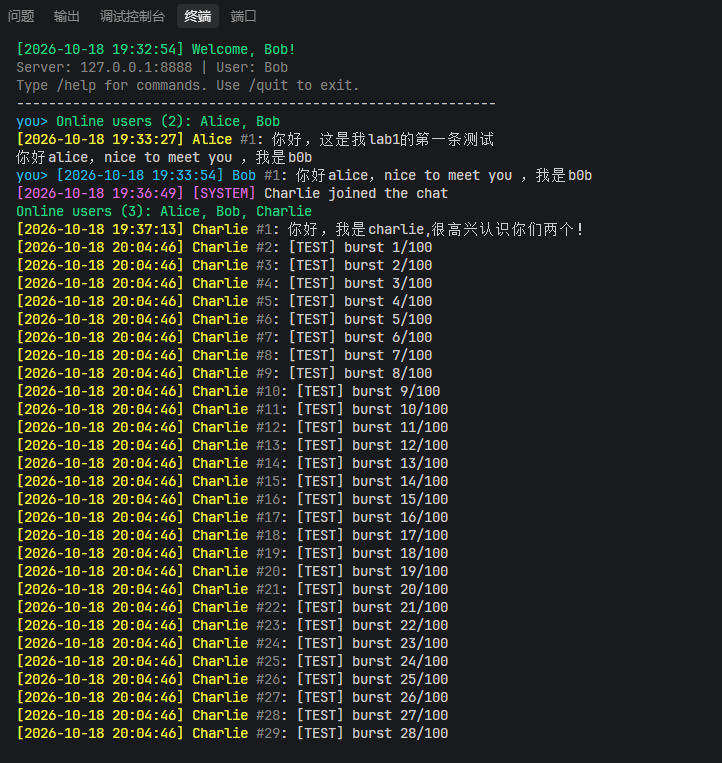
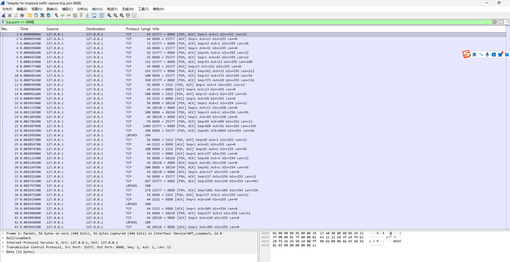
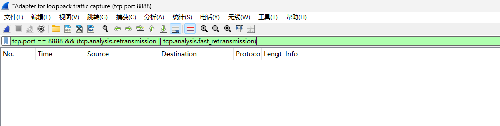

<div align=center></div>

<div align='center' ><font size='6'>计算机网络实验报告</font></div>


<div align='center' ><font size='6'></font></div>
<div align='center' ><font size='5'>实验一：TCP多人聊天程序</font></div>
<div align=center></div>
<div align='center' ><font size='6'></font></div>
<div><div style="display: flex; justify-content: center; align-items: center; flex-direction: column;">
    <div style="display: flex; flex-direction: column; align-items: flex-start; margin-top: 20px; font-size: 18px;">
        <div style="margin-bottom: 10px;">学 院：密码与网络空间安全学院</div>
        <div style="margin-bottom: 10px;">专 业：密码科学与技术</div>
        <div style="margin-bottom: 10px;">学 号：2412103</div>
        <div style="margin-bottom: 10px;">姓 名：唐健</div>
    </div>
</div>

<div style="page-break-after:always"></div>


# 一、实验目标与总体设计

## 1.1 实验任务

本实验的任务是使用**流式 Socket（TCP）**设计并实现一个多人聊天程序。按照课程要求，程序需要由 C/C++ 编写，使用基本 Socket 函数完成通信，聊天消息包含时间信息，支持中文和英文，并通过多线程同时服务多个聊天用户。实验报告还应完整说明所设计协议的消息语法、语义、时序与处理方式，给出程序模块划分、功能、流程图和运行方法，并观察通信过程中是否出现数据包丢失。

本次实现命名为 **NEXUS CHAT**。它采用客户端—服务器（Client/Server，C/S）结构：一个 TCP 服务器统一处理连接和消息转发，多个客户端通过各自的 TCP 连接加入聊天室。用户在命令行输入消息，服务器接收后附加时间戳、发送者及消息序号，再转发给当前在线的客户端。

本实验的工作集中在三个部分：首先设计能够在 TCP 字节流中明确划分消息边界的应用层协议；其次实现面向多个客户端的并发消息处理；最后结合实际程序运行与 Wireshark 抓包理解 TCP 的传输行为。

## 1.2 功能与技术路线

| 要求                   | 本程序采用的实现方式                                                                                                   |
| ---------------------- | ---------------------------------------------------------------------------------------------------------------------- |
| 流式 Socket            | 基于 TCP，使用 Windows Winsock2 的 `SOCK_STREAM` 与 `IPPROTO_TCP`                                                  |
| 自定义聊天协议         | 固定 12 字节帧头、消息类型及长度前缀负载；分别定义注册、聊天、列表、退出和错误消息                                     |
| 聊天消息带时间         | 服务器转发时添加 `YYYY-MM-DD HH:MM:SS` 格式的本地时间戳                                                              |
| C/C++ 原生 Socket 编程 | C++17；直接调用 `socket()`、`bind()`、`listen()`、`accept()`、`connect()`、`send()`、`recv()` 等基本函数 |
| 中英文聊天             | 使用 UTF-8 编码，在 Windows 控制台设置 UTF-8 输入和输出代码页                                                          |
| 多线程与多人聊天       | 服务器为每个连接创建独立工作线程；客户端以输入主线程和接收线程并行工作                                                 |
| 界面与使用说明         | 彩色命令行界面，提供普通聊天、`/help`、`/list`、`/burst N` 和 `/quit`                                          |
| 丢包观察               | 使用 `/burst` 连续发送带序号消息，并结合 Wireshark 观察 TCP 数据包和重传                                             |

程序使用的是自行组织的协议编码与解码代码，未采用 Boost.Asio、Qt Network 等封装后的 Socket 通信框架。`std::thread`、`std::mutex` 等 C++ 标准库设施用于线程与共享数据管理。

# 二、聊天协议设计

协议设计是本次实验的核心。TCP 只负责可靠、有序地传送字节流，并不区分“这一条聊天消息从哪里开始、在哪里结束”。因此，本程序在 TCP 之上定义了 **NEXUS CHAT 应用层协议**，将用户名注册、聊天内容、时间戳、在线用户信息及异常通知封装成独立的协议帧。

## 2.1 协议运行环境及基本约定

- **传输层协议：** TCP，使用 `SOCK_STREAM`。
- **通信方式：** 客户端与服务器建立独立 TCP 连接；聊天数据经服务器广播，不采用客户端直接互连。
- **文本编码：** UTF-8，文本长度按照实际编码后的**字节数**计算。
- **整数编码：** 多字节整数统一采用网络字节序（大端序，最高有效字节在前）。
- **消息组织：** 一个应用层消息对应一帧，采用“固定长度帧头 + 可变长度负载”的结构。
- **时间约定：** 聊天消息的时间由服务器生成，格式为 `YYYY-MM-DD HH:MM:SS`，精度为秒，采用服务器本地时间。
- **客户端身份：** 登录时提供用户名，同一时刻已注册在线的用户名不可重复。
- **长度与人数限制：** 帧负载最大 1 MiB；用户名为 1～48 个 UTF-8 字节；聊天正文为 1～4096 个 UTF-8 字节；服务器最多允许 256 个已注册用户同时在线。

这些限制由程序中的协议常量和服务器校验代码共同约束。长度限制与 TCP 报文大小无关，主要用于约束应用层消息规模和避免异常分配。

## 2.2 通用协议帧语法

所有消息共用一个 **12 字节固定帧头**，其结构如下。

| 字节偏移 | 字段              | 长度 | 含义及取值                                       |
| -------: | ----------------- | ---: | ------------------------------------------------ |
|     0～3 | `Magic`         |  4 B | 固定 ASCII 字节 `NCHT`，用于识别本协议         |
|        4 | `Version`       |  1 B | 协议版本，当前为 `0x01`                        |
|        5 | `Type`          |  1 B | 消息类型，编号 1～9                              |
|     6～7 | `Reserved`      |  2 B | 保留字段，当前版本必须为 `0x0000`              |
|    8～11 | `PayloadLength` |  4 B | 负载字节数，32 位无符号大端整数                  |
|    12 起 | `Payload`       |  N B | 按 `Type` 解析的负载，长度为 `PayloadLength` |

因此，单帧的逻辑格式为：

```text
0                  4  5  6     8           12
+------------------+--+--+-----+------------+
| Magic: "NCHT"    |Ver|Ty|Rsv | Length (BE)|
+------------------+--+--+-----+------------+
|            Payload (N bytes)              ...
+---------------------------------------------+

Total frame length = 12 + N bytes
```

**如何识别完整消息：** 接收端先读取恰好 12 字节的帧头，检查魔数、版本、类型、保留字段和负载长度，再按照 `PayloadLength` 读取剩余字节。这样，无论网络层一次交付半条消息还是几条消息，应用层都能恢复独立的帧边界。

### 2.2.1 基础字段编码

协议负载使用三种基础字段：

| 基本类型   | 二进制表示                                      | 用途                             |
| ---------- | ----------------------------------------------- | -------------------------------- |
| `UInt16` | 2 字节无符号大端整数                            | 字符串字节长度、用户列表人数     |
| `UInt64` | 8 字节无符号大端整数                            | 聊天消息序号                     |
| `String` | `UInt16(length)` + `length` 字节 UTF-8 文本 | 用户名、时间、消息正文、提示信息 |

例如，字符串 `Alice` 长度为 5 字节，它的负载编码为：

```text
00 05 41 6C 69 63 65
|----|-------------|
长度=5    "Alice"
```

再例如，客户端使用 `HELLO` 注册 `Alice`，一条完整协议帧可以表示为：

```text
4E 43 48 54  01 01  00 00  00 00 00 07  00 05 41 6C 69 63 65
-----------  -----  -----  -----------  --------------------
   NCHT      V / T   保留   负载长=7          用户名 Alice
```

该帧长度为 **19 字节**，其中帧头 12 字节、负载 7 字节。由此可见，协议中记录的是应用消息的字节长度，不是某次 TCP `send()` 的调用次数，也不是网络中实际 TCP 段的数量。

## 2.3 消息类型、负载语法与方向

协议定义 9 种消息类型。下表中的字段顺序即实际的**序列化顺序**；逗号只表示字段依次排列，不占用网络字节。

| 类型值 | 消息名            | 方向   | `Payload` 语法                                               | 语义                       |
| -----: | ----------------- | ------ | -------------------------------------------------------------- | -------------------------- |
|      1 | `HELLO`         | C → S | `String(username)`                                           | 发起用户注册               |
|      2 | `WELCOME`       | S → C | `String(time), String(text)`                                 | 确认注册成功并返回欢迎信息 |
|      3 | `CHAT`          | C → S | `UInt64(seq), String(message)`                               | 提交聊天消息及发送序号     |
|      4 | `CHAT_DELIVERY` | S → C | `UInt64(seq), String(time), String(sender), String(message)` | 服务器广播聊天消息         |
|      5 | `SYSTEM`        | S → C | `String(time), String(text)`                                 | 用户加入、退出等系统通知   |
|      6 | `USER_LIST`     | S → C | `UInt16(count), count × String(username)`                   | 告知当前在线用户名列表     |
|      7 | `GOODBYE`       | C → S | 可选 `String(reason)`                                        | 请求正常退出               |
|      8 | `ERROR`         | S → C | `String(text)`                                               | 报告协议或业务处理错误     |
|      9 | `LIST_REQUEST`  | C → S | 空负载                                                         | 查询实时在线用户列表       |

其中 C 表示 Client，S 表示 Server。服务器发送的 `CHAT_DELIVERY` 会广播至所有当前在线客户端，**包括消息发送者本人**。代码中类型 8 的 C++ 枚举名使用 `ERROR_MESSAGE`，以避开 Windows 头文件的 `ERROR` 宏；其在线协议编号仍然是 **8**，语义仍为 `ERROR`。

### 2.3.1 消息字段的含义

`HELLO.username` 用于确定本次连接的聊天身份；`CHAT.seq` 是**该客户端独立维护的递增序号**，而非整个聊天室统一的消息编号。`CHAT_DELIVERY.time` 由服务器接收并转发消息时生成，`sender` 取自已注册连接的用户名，服务器不会直接信任客户端自行声明的发送者身份。

`USER_LIST.count` 给出用户名条数，后面跟随相同数量的 `String(username)`。`LIST_REQUEST` 不携带字段。`SYSTEM` 与 `ERROR` 区分普通状态通知和处理失败，客户端据类型采取不同的显示方式。

## 2.4 通信时序与状态转换

### 2.4.1 连接建立与用户注册

1. 服务器执行 `socket()` → `bind()` → `listen()`，在 TCP 8888 端口等待客户端。
2. 客户端执行 `socket()` → `connect()`，TCP 连接建立后，发送首条应用层消息 `HELLO(username)`。
3. 服务器通过 `accept()` 获取连接并为其创建工作线程。该线程首先等待并解析 `HELLO`；如果第一帧不是 `HELLO`，则拒绝本次注册。
4. 服务器检查用户名是否为空、是否超长、是否含控制字符、是否与在线用户重复，以及注册用户数量是否达到上限。
5. 验证通过后，服务器先发送 `WELCOME`，再将该会话登记到在线用户集合。
6. 服务器向已有用户广播加入通知，并向在线用户发送更新后的 `USER_LIST`。如果验证失败，则发送 `ERROR` 并关闭连接。

这种安排使客户端只有在确认收到 `WELCOME` 后才进入正常聊天阶段，降低“尚未完成登录便接收普通聊天消息”的可能性。

### 2.4.2 聊天消息发送与广播

1. 发送客户端为新消息分配单调递增的 `seq`，构造 `CHAT(seq, message)` 并发送。
2. 服务器读取完整 `CHAT` 帧，验证消息正文、负载结构和序号是否合理。
3. 服务器以当前本地时间生成 `time`，从已注册会话取得 `sender`，形成 `CHAT_DELIVERY(seq, time, sender, message)`。
4. 服务器遍历当前在线会话，通过相应 Socket 将该帧发给每一个客户端。
5. 客户端接收线程解析 `CHAT_DELIVERY`，在屏幕上显示时间戳、用户名、序号和正文。

序号保留了消息的发送来源，因此两个客户端都可能各自发送 `seq = 1`，不会发生冲突。服务器日志中的 *successful socket sends* 表示向多少个客户端成功执行了完整帧发送，**不是客户端已经阅读消息的确认回执**。

### 2.4.3 在线列表与退出

客户端输入 `/list` 时发送空负载 `LIST_REQUEST`。服务器读取当前注册会话集合，返回包含人数和用户名的 `USER_LIST`。客户端输入 `/quit` 时发送 `GOODBYE`，服务器删除会话、关闭对应 Socket，并向其余用户广播离开通知和更新后的在线列表。异常断开时，服务器也会在 `recv()` 返回失败后清理连接。

### 2.4.4 典型交互时序

```text
   Alice                    Server                     Bob
     |                         |                         |
     |---- TCP connect ------->|                         |
     |---- HELLO(Alice) ------>|                         |
     |<--- WELCOME ------------|                         |
     |                         |<------- TCP connect ----|
     |                         |<------- HELLO(Bob) -----|
     |                         |-------- WELCOME ------->|
     |<--- SYSTEM(Bob joined)--|                         |
     |<--- USER_LIST ----------|-------- USER_LIST ----->|
     |                         |                         |
     |---- CHAT(seq=1,text) -->|                         |
     |<--- CHAT_DELIVERY ------|------ CHAT_DELIVERY --->|
     |                         |                         |
     |---- LIST_REQUEST ------>|                         |
     |<--- USER_LIST ----------|                         |
     |                         |                         |
     |---- GOODBYE ----------->|                         |
     |                         |--- SYSTEM(Alice left) ->|
     |                         |-------- USER_LIST ----->|
     |                         |                         |
```

以上为典型协议时序。服务器与多个客户端并发运行，因而不同用户发出的消息可以交错处理；协议不承诺所有客户端观察到严格一致的**跨发送者全局消息顺序**。

## 2.5 协议校验与异常处理

| 情况                                 | 处理方式                                       |
| ------------------------------------ | ---------------------------------------------- |
| 非 `NCHT` 帧头或协议版本不匹配     | 判定协议帧无效，终止该连接的接收处理           |
| 保留字段不为 0 / 类型超出 1～9       | 判定帧头无效                                   |
| 负载长度超过 1 MiB                   | 拒绝读取超长负载，结束该连接处理               |
| 负载字段不足或存在多余字段           | 视对应消息为格式错误；普通消息可返回 `ERROR` |
| 首条消息不是 `HELLO`               | 返回错误并关闭连接                             |
| 用户名为空、过长或重复               | 返回错误，不允许其进入在线列表                 |
| 聊天正文为空、过长或包含控制字符     | 返回 `ERROR`，不转发该条聊天消息             |
| 发送序号不大于该客户端上一次有效序号 | 返回 `ERROR`，拒绝该条消息                   |
| 某客户端意外断开                     | 清理对应会话，其他连接继续运行                 |

协议没有实现应用层独立 ACK、选择重传或滑动窗口机制，因为本次实验要求使用**TCP 流式套接字**，基础字节流可靠性由 TCP 负责。消息序号主要用于应用层完整性观察和辅助定位异常。

## 2.6 TCP 粘包与半包的处理

TCP 不传递应用层报文边界。例如，一条应用消息可能分成多次 `recv()` 才全部到达，也可能几条应用消息的数据被连续读取。如果直接把每次 `recv()` 的返回值当成一条聊天消息，程序将无法正确恢复聊天文本。

本程序在 `protocol.h` 中实现 `recv_exact()`，只有读满指定长度才返回成功，其核心逻辑如下：

```cpp
inline bool recv_exact(SOCKET socket, std::uint8_t* data,
                       std::size_t length) {
    std::size_t received_total = 0;
    while (received_total < length) {
        const auto remaining = length - received_total;
        const int chunk = static_cast<int>(
            std::min<std::size_t>(remaining,
                                  static_cast<std::size_t>(INT_MAX)));
        const int received = ::recv(
            socket, reinterpret_cast<char*>(data + received_total),
            chunk, 0);
        if (received == SOCKET_ERROR || received == 0) return false;
        received_total += static_cast<std::size_t>(received);
    }
    return true;
}
```

接收帧时，`recv_frame()` 先调用 `recv_exact()` 读取 12 字节帧头，再解析 `PayloadLength`，随后再次调用 `recv_exact()` 读取对应负载。发送端的 `send_all()` 采用相同的循环思想，避免因一次 `send()` 只发送了部分数据而遗漏后续字节。

# 三、程序设计与实现

## 3.1 系统架构与模块划分

整个程序由三个主要源码文件组成：

| 文件           | 功能                                                     | 主要接口或对象                                                                                                    |
| -------------- | -------------------------------------------------------- | ----------------------------------------------------------------------------------------------------------------- |
| `protocol.h` | 协议定义、帧封装、整数与字符串编解码、完整收发           | `Type`、`Frame`、`Writer`、`Reader`、`send_all()`、`recv_exact()`、`send_frame()`、`recv_frame()` |
| `server.cpp` | TCP 监听、接入注册、会话管理、多线程处理、消息广播、日志 | `ClientSession`、`handle_client()`、`broadcast_frame()`、`broadcast_user_list()`、`finish_session()`    |
| `client.cpp` | TCP 连接、用户输入、命令解析、异步接收及终端展示         | `connect_to_server()`、`receive_loop()`、`send_chat()`、`print_chat()`、`print_system()`                |

`protocol.h` 负责两端共有的编解码规则；服务器专注会话状态与转发；客户端专注输入、接收和展示。网络连接本身始终通过基本 Winsock API 操作，没有额外引入封装 Socket 的第三方类库。

## 3.2 服务器端执行流程

服务器采用主线程监听、工作线程处理客户端的并发模型。启动时，程序通过 `WSAStartup()` 初始化 Winsock，创建 TCP 流式 Socket，将其绑定至 `0.0.0.0:8888`，随后调用 `listen()` 进入监听状态。

主线程通过 `accept()` 循环接收连接。每当有新客户端接入，服务器便创建一个 `ClientSession` 会话对象，并启动独立线程执行 `handle_client()`。主线程继续监听后续连接，各工作线程则分别处理对应客户端的注册、消息收发与退出操作，使多个用户能够同时在线聊天。


<div align="center">
  <p><sub>图 1　服务器端流程图</sub></p>
</div>


工作线程首先接收客户端发送的 `HELLO` 消息，检查用户名是否有效、是否重复以及在线人数是否超过限制。验证通过后，服务器发送 `WELCOME`，将客户端加入在线列表，并广播用户加入通知及更新后的 `USER_LIST`。验证失败时，服务器返回 `ERROR` 并关闭当前连接。

注册完成后，工作线程进入消息处理循环，根据收到的协议类型执行相应操作：

- **CHAT：** 验证消息内容及序号，生成服务器时间戳，并向所有在线客户端广播消息。
    
- **LIST_REQUEST：** 获取当前在线用户列表，将 `USER_LIST` 返回给请求者。
    
- **GOODBYE 或连接断开：** 清理客户端会话，关闭 Socket，通知其他用户并更新在线列表。
    

`ClientSession` 保存 Socket、客户端地址、用户名、连接状态及最近一次有效的消息序号。服务器通过 `g_clients_mutex` 保护在线会话集合，并使用每个会话独立的 `send_mutex` 防止多个线程同时向同一 Socket 写入数据。

消息广播由 `broadcast_frame()` 完成：

```
std::size_t broadcast_frame(const chatproto::Frame& frame) {
    const auto sessions = snapshot_clients();
    std::size_t delivered = 0;
    for (const auto& session : sessions) {
        if (session->send_frame(frame)) ++delivered;
    }
    return delivered;
}
```

函数先获取在线会话列表的快照，再逐一发送消息，避免在网络发送期间持续占用全局会话锁。返回值记录成功完成 Socket 帧发送的连接数量，用于服务器运行日志。该数值反映发送操作的结果，不直接代表接收端已经完成消息处理。

当客户端退出或连接异常时，服务器通过 `finish_session()` 移除会话、关闭连接，并向剩余在线用户广播状态变化，完成对应工作线程的通信流程。

## 3.3 客户端执行流程

客户端采用输入主线程与消息接收线程并行工作的结构。程序启动后读取服务器地址、端口和用户名，通过 `getaddrinfo()` 获取目标地址，再调用 `socket()` 和 `connect()` 建立 TCP 连接。

连接建立后，客户端发送 `HELLO` 注册消息，并等待服务器返回 `WELCOME`。注册成功后，程序进入聊天界面，同时启动接收线程执行 `receive_loop()`；若服务器返回 `ERROR` 或连接失败，则显示原因并退出。

  

<div align="center"><sub>图 2　客户端流程图</sub></div>

登录成功后，两个线程分别承担以下任务：

- **主线程：** 读取用户输入，识别聊天文本与操作命令。普通文本封装为 `CHAT` 消息发送；`/list` 请求在线用户列表；`/quit` 发送 `GOODBYE` 并结束连接。此外，程序还提供 `/help` 查看命令说明，以及 `/burst N` 连续发送测试消息。
    
- **接收线程：** 持续读取完整协议帧，根据消息类型解析并显示聊天正文、时间戳、发送者、在线用户列表及系统通知。当服务器断开连接或接收失败时，更新连接状态并提示用户。
    

双线程结构使客户端能够同时完成用户输入和网络消息接收。即使主线程正在等待键盘输入，接收线程仍可及时处理服务器推送的消息，避免聊天过程中的相互阻塞。

客户端为每条聊天消息维护递增的 `outgoing_sequence`，通过 `CHAT(sequence, message)` 将序号与正文一同发送。服务器广播的 `CHAT_DELIVERY` 保留该序号，并附加统一的时间戳和发送者用户名。接收线程根据消息类型进行解析，同时记录各发送者的消息序号，以辅助观察连续发送测试中的消息缺失或重复现象。

退出时，客户端关闭 TCP 连接，等待接收线程结束，最后释放 Socket 和 Winsock 资源，完成整个通信过程。
## 3.4 多线程与共享资源保护

服务器采用**一连接一工作线程**的方式服务多个客户端，不需要等一个用户结束聊天才处理下一个用户。每个线程使用自己的 Socket 和消息序号状态；共享在线会话集合通过互斥锁保护。

同一个客户端可能同时收到来自不同服务器工作线程的广播，因此在向某条连接写入完整帧时使用 `send_mutex`，避免多个线程的帧字节交叉写入同一条 TCP 字节流。终端输出同样有互斥锁保护，以减少接收线程和主线程同时打印时的文字交错。

需要注意，本版本是课程实验规模的线程模型，程序声明的 **256** 是注册用户数上限，并不代表已经使用线程池，也不代表服务器对所有尚未登录连接具备完整的资源配额机制。

## 3.5 中文编码、时间戳与终端显示

聊天文本使用 UTF-8。Windows 端在启动时调用 `SetConsoleCP(CP_UTF8)` 和 `SetConsoleOutputCP(CP_UTF8)`，并在可用时开启 ANSI 终端控制序列，以便使用颜色区分系统通知、用户名和错误信息。UTF-8 编码使中英文能够使用同一套协议字段传输；协议不按“汉字个数”推断字符串字节长度。

时间戳由服务器的 `timestamp_now()` 生成，使用 `localtime_s()` 转换本地时间，再通过 `std::put_time()` 格式化为 `YYYY-MM-DD HH:MM:SS`。服务器构造 `CHAT_DELIVERY` 时附加时间，客户端根据收到的时间直接显示。

## 3.6 运行日志与可观察性

服务器为连接建立、用户加入/离开、收到聊天消息、消息序号和发送结果打印日志。聊天消息的日志格式包含客户端用户名、`seq` 和成功进行 Socket 发送的连接数。客户端显示消息的时间、用户名与序号，也能在发现同一发送者序号异常时给出提示。

这些日志为后续演示和实验分析提供依据：协议传输流程可以通过两个客户端的聊天记录、服务器日志及 Wireshark 中的 TCP 流量相互对照。

# 四、实验环境与运行方法

## 4.1 实验环境

| 项目               | 实际配置                                                    |
| ------------------ | ----------------------------------------------------------- |
| 操作系统           | Microsoft Windows 11 Home China，64 位，版本 `10.0.26200` |
| 编程语言           | C++17                                                       |
| 编译器             | MSYS2 MinGW-w64 GCC（`g++`）15.2.0，Rev8                  |
| 编译器路径         | `D:\MSYS2\ucrt64\bin\g++.exe`                             |
| 编译目标           | `x86_64-w64-mingw32`                                      |
| 网络 API           | Windows Winsock2，链接 `ws2_32`                           |
| 服务器监听地址     | `0.0.0.0:8888`                                            |
| 本机客户端连接地址 | `127.0.0.1:8888`                                          |
| 抓包工具           | Wireshark 4.6.0（按抓包界面显示），回环抓包接口             |

从实际终端输出可见，运行 `build.bat` 后出现 `[SUCCESS] Build completed.`，并提示生成 `bin\server.exe` 与 `bin\client.exe`，说明该环境下两端源码已经通过编译。

## 4.2 编译与启动

在 VS Code 的 PowerShell 终端中进入项目目录：

```powershell
cd D:\dasanshangbaogao\jiwang\lab1
.\build.bat
```

构建脚本自动检测可用的 C++ 编译器，在本次环境中选用 MinGW-w64。生成的可执行文件位于 `bin/` 文件夹。接下来分别在四个终端窗口执行：

**窗口 1——服务器：**

```powershell
.\bin\server.exe 8888
```

**窗口 2——客户端 Alice：**

```powershell
.\bin\client.exe 127.0.0.1 8888 Alice
```

**窗口 3——客户端 Bob：**

```powershell
.\bin\client.exe 127.0.0.1 8888 Bob
```

**窗口 4——客户端 Charlie：**

```powershell
.\bin\client.exe 127.0.0.1 8888 Charlie
```

服务器负责保持监听，三个客户端分别连接相同的服务器端口。也可以通过 `run_demo.bat` 启动本机演示环境。

## 4.3 命令行使用方法

| 输入                               | 作用                            |
| ---------------------------------- | ------------------------------- |
| 普通文本，例如 `大家好！`        | 向服务器发送聊天消息            |
| 普通文本，例如 `Hello everyone!` | 发送英文聊天消息                |
| `/help`                          | 显示支持的命令和使用说明        |
| `/list`                          | 查询当前在线用户名列表          |
| `/burst 100`                     | 连续发送 100 条带编号的测试消息 |
| `/quit`                          | 向服务器发送退出消息并关闭连接  |

`/burst N` 接受 **1～500** 范围内的整数。测试消息正文为 `[TEST] burst i/N`，其中 `i` 是本轮批量测试中的编号；输出中的 `#seq` 则是该客户端连接以来的**累计消息序号**，两者不一定相等。

# 五、实验过程与功能验证

## 5.1 服务器启动与客户端接入

首先启动服务器，在命令行中观察其监听日志和客户端连接日志。服务器作为统一消息转发节点，客户端登录后无需直接知道其他客户端的 IP 地址。



<div align="center"><sub>图 3　服务器启动、监听和连接日志</sub></div>

随后分别启动 Alice、Bob、Charlie 三个客户端。三者分别建立独立 TCP 连接，用户名由各自的 `HELLO` 消息提供。客户端收到 `WELCOME` 后进入聊天界面；新用户加入时，服务器向其他用户发布系统通知。



<div align="center"><sub>图 4　Alice 客户端聊天界面</sub></div>



<div align="center"><sub>图 5　Bob 客户端聊天界面</sub></div>



<div align="center"><sub>图 6　Charlie 客户端聊天界面</sub></div>

这组三客户端截图用于记录多用户登录、消息显示和聊天交互。结合服务器端连接日志，可以检查程序是否在同一服务器端口上同时处理多个会话。中英文消息采用相同的 `CHAT` / `CHAT_DELIVERY` 路径处理，显示内容包含服务器时间戳、用户名和消息正文。

## 5.2 查询实时在线用户

在客户端输入 `/list`，触发 `LIST_REQUEST`，服务器随后返回 `USER_LIST`。客户端解析人数以及每个用户名并在终端显示。该列表由服务器当前登记的用户集合生成，不依赖客户端写死的用户名。



<div align="center"><sub>图 7　实时在线用户列表的查询结果</sub></div>

这一操作同时检查了一个与聊天转发不同的协议分支：客户端发出的是**控制消息**，服务器返回结构化用户数据，而非普通聊天文本。

## 5.3 连续消息发送与完整性观察

为观察连续通信情况下的程序表现，客户端支持 `/burst N` 测试指令。执行 `/burst 100` 时，客户端连续构造 100 条 `CHAT` 帧，每条都携带单调递增的发送序号。服务器接收后逐条生成 `CHAT_DELIVERY`，并转发给在线用户。



<div align="center"><sub>图 8　`/burst` 连续消息测试的终端记录</sub></div>

判断消息是否完整，需要在接收端检查**发送者对应的累计序号是否连续**，并与本次 `/burst` 发送的起止序号和消息内容相对应。需要强调：`/burst 100` 表示发送 100 条**应用层聊天消息**，不能等同于恰好产生 100 个 TCP 数据包。连续写入的消息可能被 TCP 合并，也可能拆分成多个 TCP 数据段。

本报告保留图 8 作为本次运行记录；若要计算严格的“100 条全部到达”统计结论，还需要从接收端日志核对起止序号与条数，不能仅凭发送端提示 `Burst finished` 认定全部送达。

# 六、TCP 数据包捕获与丢包观察

## 6.1 抓包方案

由于本次客户端和服务器运行于同一台 Windows 11 电脑，程序通过 `127.0.0.1:8888` 通信，属于**本机回环流量**。实验使用 Wireshark 的 `Adapter for loopback traffic capture` 接口抓取通信数据。

开始抓包前使用捕获过滤器：

```text
tcp port 8888
```

抓包完成后可用显示过滤器：

```text
tcp.port == 8888
```

前者是抓取阶段使用的捕获过滤器语法，后者是 Wireshark 列表上方的显示过滤器语法，两者不能互换。抓包时触发客户端发送聊天信息和 `/burst` 连续消息，以便观察 TCP 数据段、确认报文和可能出现的重传。

## 6.2 TCP 报文分析



<div align="center"><sub>图 9　Wireshark 捕获的 TCP 8888 通信数据包</sub></div>

从实际提供的 Wireshark 截图中可以辨认出源地址和目的地址均为 `127.0.0.1`，其中一条数据段的通信方向是 **源端口 25377 → 目的端口 8888**。这说明抓到了客户端向监听端口发送的数据；相应的 **8888 → 25377** 报文则来自服务器方向。

截图中的该条 TCP 数据段显示 `PSH, ACK`，`Seq=1`，`Ack=1`，`Len=12`。此处 `Len=12` 表示该 TCP 段的数据部分长度为 12 字节，而 NEXUS CHAT 协议帧头恰好也是 12 字节。后续 TCP 段可继续承载负载数据，说明协议帧并不必然通过单个 TCP 段传送。

在抓包的十六进制数据区可以观察到 ASCII 字节 **`NCHT`**，与自定义协议帧头的魔数字段一致。这一证据使程序的协议设计与真实网络通信对应起来：应用层定义的 `Magic`、`Version`、`Type` 和 `PayloadLength` 最终以二进制字节形式进入 TCP 字节流。

其中，`Seq` 表示 TCP **字节序列号**，`Ack` 表示 TCP **确认号**，与程序中 `CHAT` 使用的应用层消息序号是两个不同的概念。TCP 确认号用于确认字节流已接收的范围，不能直接代替程序的聊天消息计数。

## 6.3 重传过滤与实验结果

在 Wireshark 的显示过滤器栏输入：

```text
tcp.port == 8888 &&
(tcp.analysis.retransmission || tcp.analysis.fast_retransmission)
```

该过滤器用于检查 Wireshark 根据 TCP 序列号和时序分析识别出的重传与快速重传。将此检查结果与连续消息测试的应用层序号记录相结合，可以从两个层次观察传输过程。



<div align="center"><sub>图 10　TCP 重传过滤结果</sub></div>

本次保存了 `tcp无重传.png` 作为重传检查截图。**若该截图中的过滤结果为空**，则本次结论应表述为“在所捕获的 TCP 8888 流量中，Wireshark 未识别出满足上述过滤条件的重传报文”。这与正常本机回环通信的表现一致，但不意味着可以严格证明网络绝无丢包。

本实验不能直接给出准确的物理链路丢包率：一方面，本机回环数据不经过外部物理网络链路；另一方面，TCP 具有确认与重传机制，即使底层发生过丢包，应用层仍可能最终收到完整数据。此外，Wireshark 未观察到重传也仅说明本次抓包与该过滤条件下**没有发现相应证据**，并不能推出任何网络条件下的零丢包结论。

因此，本次观察的重点有两项：**应用层**检查聊天消息序号和正文是否连续、完整；**传输层**检查 TCP 报文及其可能的重传行为。将两者结合，能够更准确地理解 TCP 可靠传输在聊天程序中的作用。

# 七、实验过程中遇到的问题及分析


## 7.1 TCP 数据流中的消息边界

实现聊天程序时必须解决的问题是：一次 `send()` 与一次 `recv()` 之间不存在“一条消息对一条消息”的关系。如果接收端直接把一次 `recv()` 的返回内容当成完整聊天消息，就可能读到不完整字段，或把多条消息错误地合在一起。

程序采用固定帧头和长度前缀编码，配合 `send_all()` 与 `recv_exact()` 循环处理。该设计将聊天消息的边界恢复交给应用层协议，与操作系统对 TCP 数据分段的方式解耦。

## 7.2 多线程广播时的并发访问

多名用户可以同时发送消息，服务器不同工作线程可能同时访问在线用户列表，或同时向某个接收客户端写入数据。如果不加同步控制，容易出现共享容器竞争或协议帧字节交叉写入的问题。

程序通过 `g_clients_mutex` 保护在线会话集合，并通过每个 `ClientSession` 的 `send_mutex` 串行化该 Socket 上的完整帧发送。客户端也使用输出锁保护终端打印。这样既支持并发处理多个用户，又保持单条帧发送的完整性。

## 7.3 Wireshark 过滤器语法混淆

最初使用 Wireshark 时，将 `tcp.port == 8888` 填入捕获过滤器位置，界面显示 `Invalid capture filter`。检查后区分了两种表达式：**捕获过滤器**使用 `tcp port 8888`，**显示过滤器**使用 `tcp.port == 8888`。修正后选择回环抓包接口，成功捕获到客户端与服务器之间的 TCP 数据。

这也说明，在网络实验中需要区分工具的抓取机制与显示机制，过滤器是否有效会直接影响后续分析能否获得可信数据。

# 八、实验总结

本实验围绕 TCP 流式 Socket 完成了一个支持多人聊天的 C++ 程序。设计中明确了协议帧头、消息类型、字段编码、通信时序与异常处理流程；实现中使用 Winsock2 基本 Socket 函数、多线程及互斥锁管理多个客户端，并通过服务器时间戳与 UTF-8 编码支持带时间的中英文消息。

实际构建已在 Windows 11 与 MSYS2 MinGW-w64 GCC 15.2.0 环境中成功完成，客户端与服务器的运行过程由终端截图记录。Wireshark 回环抓包能够观察到 TCP 8888 通信，并在数据中识别自定义协议的 `NCHT` 标识。结合连续消息测试和 TCP 重传过滤，可以区分应用层消息完整性与传输层丢包、重传等不同概念。

通过本次实验，对 TCP 字节流与应用层报文的关系、多客户端并发通信、协议设计与实际网络字节之间的对应关系有了更加具体的认识，也进一步理解了网络程序正确性需要由**协议、代码实现和实际通信证据**共同支撑。

