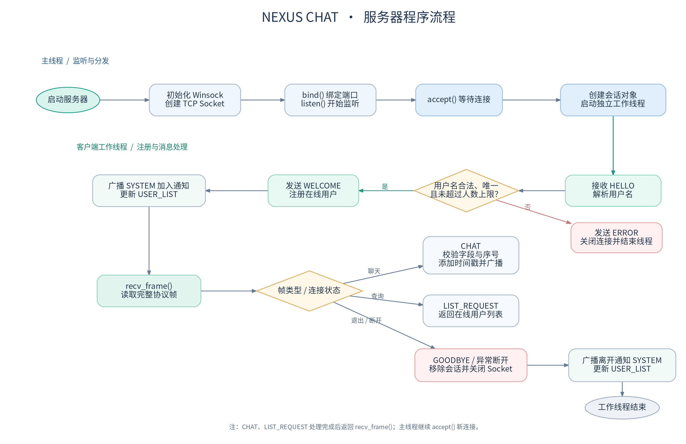
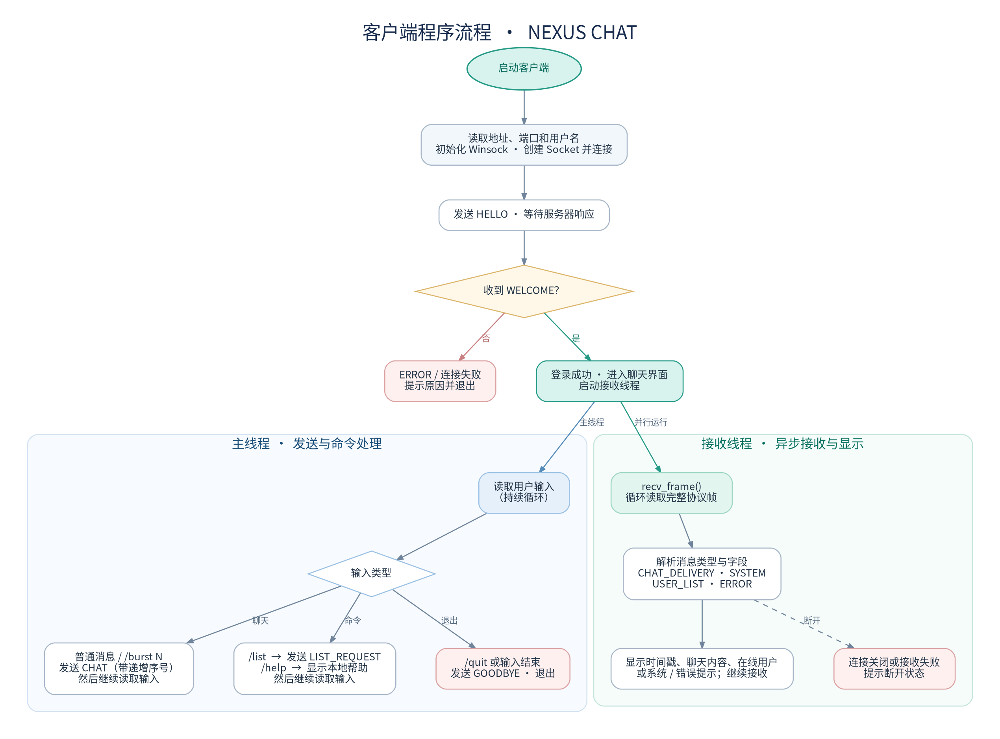

# 计算机网络实验一：利用流式套接字编写聊天程序

> **提交前必须完成：** 将方括号内的内容替换为真实信息；补充真实运行截图、实际测试结果和 Wireshark 抓包观察。未实际执行的测试不能填写为“通过”。

- 学号：【填写】
- 姓名：【填写】
- 专业/班级：【填写】
- 实验日期：【填写】
- 操作系统：【填写 Windows 版本】
- 编译器：【填写实际使用的 MSVC 或 MinGW-w64 版本】

## 一、实验目的与要求

本实验使用流式套接字设计并实现一个多人聊天程序。程序采用 TCP 传输，聊天消息带时间戳，支持中文和英文，使用多线程处理多个客户端，并通过实际运行和抓包观察通信过程。程序使用 C++ 与基本 Winsock Socket API，不依赖封装后的网络 Socket 类或网络通信框架。

## 二、协议设计

### 2.1 传输方式

程序使用 TCP（`SOCK_STREAM`）。TCP 提供可靠、有序的字节流，但不保留应用层消息边界，因此程序在每条应用消息前增加固定长度帧头，并在帧头中记录负载长度。发送端使用循环发送函数确保指定字节数全部写入；接收端先读取完整帧头，再根据长度读取完整负载。

### 2.2 帧格式

帧头为 12 字节：4 字节魔数 `NCHT`、1 字节协议版本、1 字节消息类型、2 字节保留字段、4 字节大端序负载长度。负载采用 UTF-8 字符串及长度前缀编码，最大负载为 1 MiB。

### 2.3 消息类型

| 类型 | 方向 | 作用 |
|---|---|---|
| HELLO | 客户端→服务器 | 注册用户名 |
| WELCOME | 服务器→客户端 | 确认注册成功 |
| CHAT | 客户端→服务器 | 发送带递增序号的聊天文本 |
| CHAT_DELIVERY | 服务器→所有客户端 | 转发聊天文本、服务器时间、用户名和序号 |
| SYSTEM | 服务器→客户端 | 通知用户加入或离开 |
| USER_LIST | 服务器→客户端 | 返回在线用户名列表 |
| LIST_REQUEST | 客户端→服务器 | 请求在线列表 |
| GOODBYE | 客户端→服务器 | 请求正常退出 |
| ERROR | 服务器→客户端 | 报告注册或消息错误 |

详细字段与时序见随项目提交的 `PROTOCOL_DESIGN.md`。

### 2.4 主要通信时序

客户端建立 TCP 连接后发送 HELLO。服务器验证用户名并回复 WELCOME，随后更新在线列表。客户端发送 CHAT 后，服务器验证消息和序号，生成时间戳，并将 CHAT_DELIVERY 广播给所有在线客户端。客户端退出时发送 GOODBYE，服务器清理会话并通知其他客户端。

## 三、程序设计与模块划分

### 3.1 协议模块 `protocol.h`

负责定义消息类型与帧格式，实现整数和字符串序列化/反序列化，以及 `send_all()`、`recv_exact()`、`send_frame()` 和 `recv_frame()`。通过长度前缀解决 TCP 粘包和半包导致的消息边界问题。

### 3.2 服务器模块 `server.cpp`

服务器调用 `socket()`、`bind()`、`listen()` 和 `accept()` 建立监听。每接收一个客户端连接，就创建一个独立工作线程处理注册、收发消息和断开清理。服务器维护在线客户端列表，为聊天消息生成统一时间戳并广播，同时记录连接、断开、消息序号及 Socket 发送情况。

### 3.3 客户端模块 `client.cpp`

客户端通过 `getaddrinfo()` 获取目标地址并调用 `socket()`、`connect()` 连接服务器。主线程读取用户输入并发送消息，接收线程持续解析服务器推送的聊天消息、系统通知、在线用户列表和错误信息。命令包括 `/help`、`/list`、`/burst N` 和 `/quit`。

### 3.4 程序流程图

流程图源文件：`docs/server_flowchart.dot`。

流程图源文件：`docs/client_flowchart.dot`。

## 四、实现要点

1. **多人聊天：** 服务器为每个客户端连接建立独立工作线程，使用互斥锁保护在线客户端集合及每个连接的发送操作。
2. **中英文支持：** 客户端终端设置为 UTF-8；协议按 UTF-8 字节传输，不将中文字符数误当作字节长度。
3. **消息时间：** 服务器为每条聊天消息生成 `YYYY-MM-DD HH:MM:SS` 格式的时间戳，再广播给所有客户端。
4. **在线列表：** 客户端通过 LIST_REQUEST 请求，服务器返回当前注册用户。
5. **异常处理：** 检查连接失败、畸形帧、非法用户名、重复用户名、超长消息及客户端断开。
6. **消息序号：** 每个客户端为聊天消息递增编号，接收端可提示应用层序号缺口或重复。该机制用于观察消息连续性，不替代 TCP 自身的可靠传输。

## 五、实验环境与运行方法

### 5.1 实验环境

| 项目 | 实际配置 |
|---|---|
| 操作系统 | 【填写】 |
| 编译器与版本 | 【填写】 |
| 终端 | 【填写】 |
| 服务器端口 | TCP 8888（或实际使用端口） |
| 测试客户端数量 | 【填写】 |

### 5.2 编译和运行

在 Windows 的开发者命令行中进入项目目录，运行 `build.bat`。编译成功后，在一个终端运行 `bin\\server.exe 8888`，在另外两个或更多终端分别运行 `bin\\client.exe 127.0.0.1 8888 Alice`、`bin\\client.exe 127.0.0.1 8888 Bob` 等命令。

【插入图 1：服务器成功监听端口的实际运行截图】

【插入图 2：至少两个客户端在线的实际运行截图】

【插入图 3：中英文聊天广播的实际运行截图】

【插入图 4：在线用户列表及退出通知的实际运行截图】

## 六、测试过程与结果

请根据真实运行情况填写下表。

| 编号 | 测试内容 | 操作与观察 | 结果 |
|---|---|---|---|
| 1 | 服务器启动 | 【填写】 | 【通过/失败及原因】 |
| 2 | 多客户端同时在线 | 【填写】 | 【填写】 |
| 3 | 中文消息 | 【填写】 | 【填写】 |
| 4 | 英文消息 | 【填写】 | 【填写】 |
| 5 | 时间戳 | 【填写】 | 【填写】 |
| 6 | 在线用户列表 | 【填写】 | 【填写】 |
| 7 | 正常退出和异常断开 | 【填写】 | 【填写】 |
| 8 | 连续消息 `/burst 100` | 【填写实际发送/接收情况】 | 【填写】 |
| 9 | 非法或重复用户名 | 【填写】 | 【填写】 |

## 七、数据包丢失观察

使用 Wireshark 对 TCP 8888 端口进行抓包，显示过滤器为 `tcp.port == 8888`。结合 `/burst 100` 测试，观察 TCP 数据段、ACK、重传及重复 ACK。必要时使用 `tcp.analysis.retransmission` 过滤重传报文。

【插入图 5：Wireshark 中 TCP 8888 通信流量的实际截图】

【插入图 6：重传分析结果或未观察到明显重传时的实际抓包截图】

实际观察记录：

- 抓包接口：【填写】
- 测试时长：【填写】
- 测试消息数量：【填写】
- 应用层接收情况：【填写】
- 是否观察到 TCP 重传/重复 ACK：【填写】
- 结合截图得到的结论：【填写】

需要注意，TCP 可能在传输层发生丢包并通过重传恢复，因此应用层消息完整到达不代表网络链路绝对没有丢包；没有观察到重传也不能证明测试期间绝对没有发生丢包。

## 八、实验中遇到的问题及分析

以下问题应以实际调试过程为准，未遇到的内容可删除或改写。

1. **TCP 消息边界问题。** TCP 是字节流，一次发送与一次接收没有一一对应关系。通过在帧头记录负载长度，并实现精确收发循环，接收端可以恢复完整的应用层消息边界。
2. **多人并发访问。** 多个工作线程可能同时更新在线用户列表或向同一客户端发送消息。程序使用互斥锁保护共享客户端集合，并为每个客户端的发送操作加锁，避免多线程交叉写入同一条帧。
3. **中文显示。** 中文字符在 UTF-8 中占用多个字节。协议以字节长度记录字符串，Windows 终端设置为 UTF-8，避免按字符数计算负载长度。
4. **连接断开。** 当客户端退出或连接异常时，接收函数会返回失败，服务器清理会话并更新在线列表，避免把已断开的客户端继续视为在线。

【根据自己的实际调试情况补充其他问题、错误信息、原因和解决过程。】

## 九、实验总结

本实验实现了基于 TCP 流式套接字的多人聊天程序。程序自行定义应用层帧协议，处理消息边界、注册、聊天广播、在线用户列表和退出流程，并通过多线程支持多个客户端。实验还通过中英文消息、连续消息测试及 Wireshark 抓包观察应用层消息连续性与 TCP 传输行为。

【提交前请补充真实测试结果，并根据实际观察调整本段结论。】
